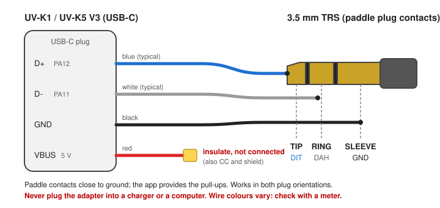

# CW Keyer overlay app

`CW Keyer` transmits manually keyed A1A-style carrier Morse on the current TX
VFO. It is entirely contained in the 4 KiB overlay and uses only API level 2;
it has no resident firmware component.

## Requirements and install

- F4HWN Labs firmware v6.2.0 or later (overlay ABI 1, API level 2).
- Build: `./compile-app.sh cwkeyer` from the repository root, output
  `build/Apps/CWKeyer.app`; install it in a free slot with UV Studio.
- The VFO must be in FM: the over-the-air signal is an unmodulated carrier
  (A1A), so the other station needs a CW or SSB receiver to hear a tone; an FM
  receiver only hears its squelch open and close.

## Controls

- `PTT`: straight-key carrier in every mode.
- Paddle port (`7`): `SIDE` uses SIDE1/SIDE2; `USB` uses a paddle or key wired
  to the USB-C connector (D+ = tip = dit, D- = ring = dah, sleeve = ground,
  VBUS and CC left open; KI6CR adapter wiring).
- `1`: toggle `STRAIGHT` / `PADDLE`.
  - `STRAIGHT`: SIDE1/SIDE2 are parallel straight keys; on `USB` only the tip
    keys, so a mono plug works.
  - `PADDLE`: automatic dits and dahs, no paddle memory. On `USB` both
    contacts are read together, so a squeeze alternates elements. On `SIDE`
    only one key is visible at a time (single-paddle keyer). Iambic A/B
    variants are withdrawn until they are validated on the bench.
- `0`: enable or mute the CW receive audio path.
- `2`: raise the keyer speed (5 to 60 WPM).
- `3`: raise the receive CW tone by 50 Hz.
- `4`: raise the semi-break-in delay by 50 ms.
- `5`: swap the dit and dah contacts.
- `6`: raise the crystal correction by one BK4829 `REG_3B` step (0.19 ppm).
- `7`: toggle the paddle port `SIDE` / `USB`.
- `F`, then `2`, `3`, `4` or `6`: lower the corresponding setting instead.
- `UP` / `DOWN`: tune the app frequency by a fixed 100 Hz CW step, up to
  +/-50 kHz. Holding a direction repeats after 400 ms, then every 100 ms.
- `EXIT`: leave the app.

| Setting | Range | Default |
|---|---|---|
| Speed (`WPM`) | 5 to 60 WPM | 18 |
| Receive tone and sidetone (`TONE`) | 300 to 900 Hz, 50 Hz steps | 700 Hz |
| Semi-break-in (`BK`) | 250 to 1500 ms, 50 ms steps | 300 ms |
| Crystal correction (`XTAL`) | -50 to +50 `REG_3B` steps | +14 (+2.69 ppm) |
| Mode / port / order | `STRAIGHT`, `PADDLE` / `SIDE`, `USB` / `DI-DA`, `DA-DI` | `STRAIGHT` / `SIDE` / `DI-DA` |

The status bar shows the title, `RX` while the transmitter is off, `TX OFF`
when a transmission is refused, the speaker or `F` icon and the app version.
A transmission is refused (`TX OFF`) when the resident firmware forbids TX on
the frequency (TX lock outside the allowed bands), when the battery is too low
or the voltage too high, or when the VFO is not in FM. Release every keying
control to clear it.

There is no help page in this build: the paddle keyer and the USB port use the
space it took.

On the `USB` port the app sets PA11/PA12 to inputs with pull-up and stops the
USB clock while it runs (a powered USB device holds D+ for about two seconds
after a contact closes); only those bits are changed and they are restored on
exit, so the PC link works again once the app is closed. There is no PC link
while the app is open.

## USB-C paddle adapter

A USB-C plug (or a cut USB-C to USB-A cable) wired to a 3.5 mm stereo jack:

| USB-C line | MCU pin | Jack | Function |
|---|---|---|---|
| D+ | PA12 | tip | dit (straight key in `STRAIGHT`) |
| D- | PA11 | ring | dah |
| GND | - | sleeve | common |
| VBUS, CC, shield | - | insulated, not connected | - |

Contacts close to ground; the app supplies the pull-ups. The adapter works in
both plug orientations. Never plug the adapter into a charger or a computer:
VBUS would be live and D+/D- would be driven by the host. A mono plug is fine
in `STRAIGHT` (the ring is ignored); in `PADDLE` a mono plug holds dah closed.

Keyer element timing is measured on the SysTick counter, so the keypad scan
done at every poll (about 0.2 ms) does not stretch the elements. Contacts must
read the same on three consecutive polls (about 3.5 ms) before a straight-key
edge or a keyer start is accepted.

The main screen shows all six controls as compact, equal-width 43-pixel
3x5-font capsules in the bottom three lines below the frequency. The left
column is anchored to the left edge, the right column to the right edge, and
every label is left-aligned inside its capsule: the mode (`STRAIGHT`,
`PADDLE`), `WPM`, `TONE`, `BK`, the port and contact order
(`SIDE DI-DA`, `USB DA-DI`, ...) and `XTAL`. The status bar shows the app
version.
The Foxhunt speaker icon shows that receive audio is enabled; the `F` icon
temporarily replaces it while reverse adjustment is armed.

The speed, mode, paddle assignment, calibration, receive pitch, break-in delay,
port and speaker state are saved when the app exits. A 0.2 configuration is
kept on upgrade; its crystal correction (hundredths of a ppm) is converted to
the nearest `REG_3B` step. The crystal correction is
written to BK4829 `REG_3B` (reference crystal word) on entry, on top of the
value found there, and that value is restored on exit. The default is 14 steps
(+2.69 ppm), for a carrier measured +400 Hz high at 144.225 MHz and +1.20 kHz
high at 433.225 MHz; a positive step lowers the carrier (checked on an SDR,
0 vs +14 steps at 433.650 MHz). The
PTT always remains a straight key, so it is usable in the paddle mode.
The frequency offset selected with `UP` / `DOWN` is local to the overlay. It is
applied equally to CW RX, TX and the displayed frequency, and resets to zero
when the app exits; the resident VFO is never modified.
Interface keys are accepted only after a stable 20 ms reading, so
keypad-matrix transients cannot change a setting. PTT is immediate; the paddle
contacts (SIDE or USB) only go through the 3.5 ms contact debounce.
Full-screen refreshes are kept out of the keying path; TX/RX transitions update
only the status line. Battery sampling is deferred until the transmitter has
fully returned to RX so it cannot stretch a mark or an inter-element space.
A continuous mark is limited to ten seconds as stuck-key protection; the key
must be released before the app will accept another transmission.

## RF keying

On the first mark, the app calls the existing `tx_set_params` API service. That
service selects the TX VFO, starts the BK4829 transmitter and enables the board
PA before returning. The app immediately removes PA drive, mutes every
audio/sub-audio source and caches BK4829 register `0x36`, whose upper byte
drives the `VRAMP` PA-bias output. It then applies the proportional crystal
correction to synthesizer registers `0x38`/`0x39`, in their native 10 Hz units,
and restarts register `0x30` through zero so the VCO recalibrates and latches
the corrected frequency.
Register `0x50` remains in TX modulation-mute for the entire session. During a
mark, register `0x30` is `0xC3FA`, matching the driver's TX-link configuration
with the microphone ADC disabled. During a space it becomes `0xC3F2`, which
also gates the BK4829 internal PA gain while leaving the PLL locked. The
unmodulated carrier is therefore keyed with three coordinated controls: the
internal PA gain, `VRAMP`, and the board PA enable.

Every mark uses a four-step, 4 ms rise and fall of the saved PA bias. Internal
PA gain and board PA enable are asserted before the rise, then removed after
the fall. Between marks the synthesizer remains locked, but internal PA gain,
PA bias and the board PA are all off.
`EXIT`, retuning, and every abort path call `tx_end` to disable the PA and restore
normal RX. After the final mark, the configurable semi-break-in hang (300 ms
by default) keeps the synthesizer ready across Morse element gaps, then
automatically calls `tx_end` and restores reception without requiring `MENU`.
The overlay then selects the BK4829 USB baseband output and tunes below the
calibrated RX frequency by the configured receive pitch (700 Hz by default),
so an incoming A1A carrier is heard at that pitch. The same pitch is used for
the local TX sidetone. When enabled, the speaker remains open throughout RX:
gating it with the FM squelch clips the start of dits and chops the tone at
every carrier transition.

The atomic `tx_set_params` service necessarily enables RF briefly before the
overlay can remove PA drive. The app then waits for the corrected synthesizer
setting to lock and applies the normal ramp to the first deliberate mark. A
spectrum/SDR check is required before assuming the four-step envelope is
spectrally clean on every power band.

Squeeze keying needs the USB port: the single-key `get_key` API shows one SIDE
key at a time. The paddle mode has automatic repeat and no paddle memory.
The TX sidetone follows the approach used by NR7Y's CW implementation: Tone1
is routed to the BK4829 `AF_ALAM` output while register `0x50` keeps TX
modulation muted. Morse edges change only the Tone1 frequency control word in
register `0x71`; writing zero silences the speaker between marks without the
pop caused by repeatedly changing either the tone-enable or AF-selector
register. At the end of the semi-break-in delay, the AF DAC gain fades to its
minimum before the selector moves to USB and the speaker amplifier is disabled.
After the RX profile is restored, the USB output settles at minimum DAC gain
before the amplifier is enabled. The gain then rises one DAC code at a time
instead of jumping directly to full level. The over-the-air signal therefore
remains A1A rather than MCW. Key `0` controls both receive audio and the TX
sidetone.

## Status and known limits

- Tested on a UV-K1 (Labs v6.2.0): USB-C paddle and straight key in both plug
  orientations, SIDE and PTT keying, every setting, exit and power-off, PC link
  after exit, no stray edges at rest, no false elements with the paddle lead
  near the antenna at high power into a dummy load, timing and decoding from
  20 to 60 WPM on an SDR.
- `PADDLE` is a plain automatic keyer without paddle memory; the 0.2 SIDE
  keyer remembered an opposite-paddle tap during an element. Iambic A/B
  (squeeze memory) is left for a later change, after on-air timing checks.
- Above about 40 WPM the fixed 4 ms ramps become a large part of a dot (20 %
  at 60 WPM): the envelope gets rounder, the bandwidth does not change.
- The K-plug line PA10 is not used as a paddle input: it follows the PTT
  button on the bench.

## Credits

- CW Keyer: Armel F4HWN.
- USB-C paddle port, paddle keyer and contact debounce: Johan Denoyer F4WAT,
  USB-C wiring after KI6CR's CW adapter for the UV-K5 V3.
- TX sidetone approach: NR7Y's CW implementation.
